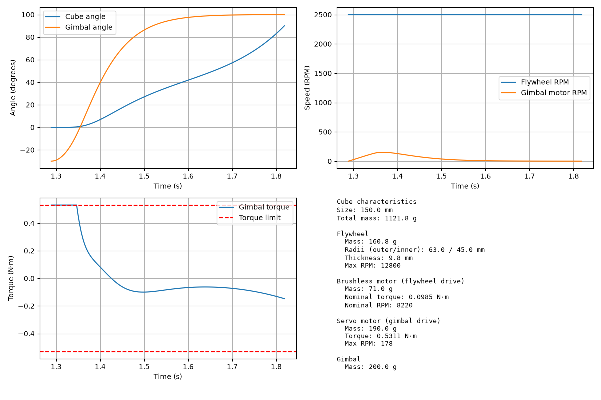

# Gimbaled Reaction Cube

Design and simulation tools for a **self-flipping cube** driven by a gimbaled
flywheel, which works as a single-gimbal control moment gyroscope (CMG). The cube
sits on one edge. A brushless motor spins a flywheel up to speed. A servo then
tilts the flywheel's gimbal, and the gyroscopic torque that results rolls the
cube 90° onto its next face.

The repository currently models the **planar (2-D) case**: rotation about a single
floor edge. It contains:

- an analytical rigid-body model integrated with SciPy, with floor contact,
- a gimbal controller (saturated PD with coupling compensation),
- a two-stage design optimiser (flywheel geometry first, then servo torque/speed),
- a Drake multibody model that re-runs a chosen design with hydroelastic contact
  and a Meshcat 3-D replay,
- plotting tools for the CSV results.



## Quick start

```bash
python3 -m venv .venv
```

```bash
source .venv/bin/activate
```

```bash
pip install -r requires.txt
```

All scripts use imports relative to `2d/`, so run them **from inside `2d/`**:

```bash
cd 2d
```

```bash
python main.py
```

`main.py` runs the full pipeline. It sweeps flywheel geometry × flywheel RPM ×
gimbal start/target angles, refines the grid around the best design, then
optimises servo torque and speed under a 50 W power limit and plots the best
flip. A full run takes a long time: the default grid has 144 flywheel candidates
before the refinement rounds, and each one is simulated at 13 RPMs × 16 angle
pairs (≈30 000 runs in the first round alone). Shrink the lists
at the top of `main.py` for a quick try.

Results are written as timestamped CSVs to `static/`.

### Drake replay (optional)

```bash
cd 2d/drake
```

```bash
python scene.py
```

This loads one row from a results CSV (`scene_case.py`: `CASE_CSV`,
`SELECTED_ROW`), builds the cube in Drake, simulates 5 s, and prints two local
URLs: a Meshcat replay with a telemetry panel and time slider, and the live
Meshcat scene.

### Plotting saved results

```python
from visualization.statistic_plotter import plot_csv_dashboard
plot_csv_dashboard("../static/FULL_RANGE_TEST_2026-11-03_20-08-21.csv", selected_row=18786)
```

Other plots: `visualization/pareto.py` (mass vs flip-time Pareto front) and
`visualization/servo_statistic_polotter.py` (servo design space).

## Repository layout

```
2d/
  main.py                    full optimisation pipeline
  hardware/                  component models (mass, inertia) and baseline parameters
  dynamics/                  equations of motion, state vector, floor contact
  control/                   flywheel spin-up profile, gimbal controller
  simulation/                single-run driver and run evaluation and sweeps
  optimisation/              generic grid+refine optimiser; flywheel and servo stages
  visualization/             CSV I/O and matplotlib dashboards
  drake/                     Drake multibody scene, telemetry replay
static/                      result CSVs and figures
docs/
  architecture.md            physics model, module reference, data flow
  code-review.md             evaluation of the current code base
```

## Documentation

- [docs/architecture.md](docs/architecture.md): equations of motion, the
  simulation pipeline, optimiser logic, CSV schema, and the module reference.
- [docs/code-review.md](docs/code-review.md): strengths, known bugs, and a
  prioritised list of improvements.

## Baseline hardware (`2d/hardware/parameters.py`)

| Component | Part / value |
|---|---|
| Cube | 150 mm edge, 0.5 kg cage (thin-walled hollow cube) |
| Flywheel motor | Maxon ECX FLAT 32 L, 24 V: 98.5 mN·m, 8220 RPM, 71 g |
| Gimbal servo | CubeMars AK40-10: 1.3 N·m, 370 RPM, 190 g |
| Flywheel | aluminium ring, Ø126/90 mm, 11.5 mm thick (≈190 g) |
| Gimbal ring | 200 g, Ø140/130 mm |

Total ≈ 1.15 kg. With this baseline, a 0°→90° gimbal move at 5000 RPM flips the
cube in about 0.19 s after a ≈3 s spin-up.

## License

See [LICENSE](LICENSE).
